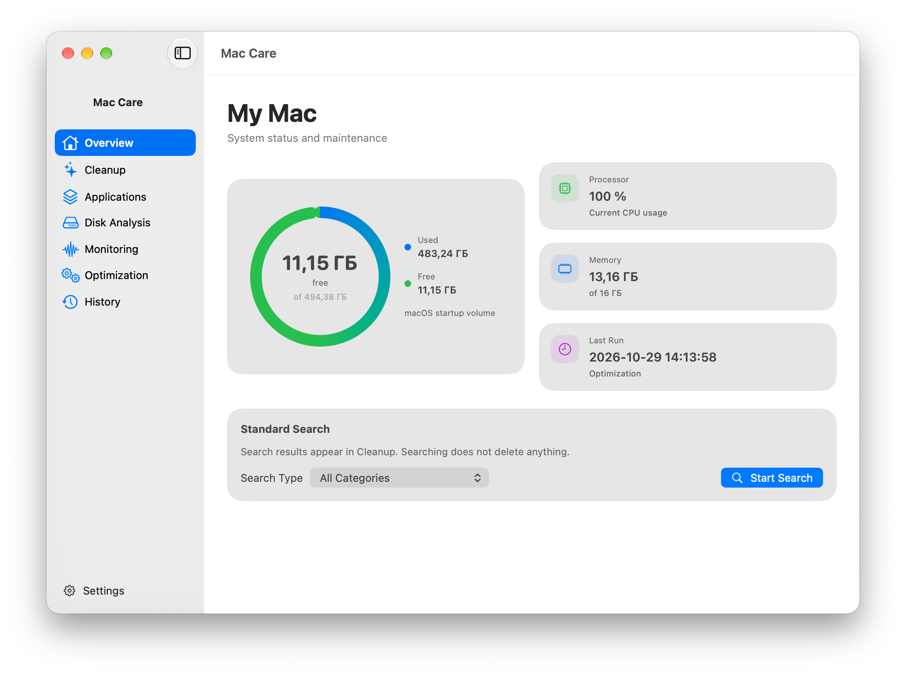

<div align="center">
  
  <h1>Mac Care</h1>
  <p><strong>Understand your Mac. Review every change.</strong></p>
  <p>A native macOS maintenance app with a clear, review-first workflow.</p>
  <p>
    
    
    
    
  </p>
</div>

Mac Care brings system insights and maintenance tools together in one native app. Choose **English or Russian** in Settings; the interface updates immediately. Technical command output is shown verbatim so diagnostic details remain intact.

## App preview

<div align="center">
  
  <p><em>Real application capture. The device and build labels are redacted; the interface and displayed readings are unchanged.</em></p>
</div>

## What you can do

| Section | What it does |
| --- | --- |
| **Overview** | Check storage, processor, and memory status, then start a standard search. |
| **Cleanup** | Choose a category, review the proposed files, and confirm cleanup separately. |
| **Applications** | Browse installed apps and their size; inspect related files before moving an app to the Trash. |
| **Disk Analysis** | Scan disk usage and explore the space used by folders. |
| **Monitoring** | View processor and memory metrics with periodic refresh. |
| **Optimization** | Review a macOS maintenance plan before choosing to run it. |
| **History** | See previous operations and available file-activity details. |

## Designed around review

1. **Search or preview** to find potential cleanup items.
2. **Inspect the list and plan** before taking action.
3. **Confirm separately** to clean files or move an app to the Trash.

Searching does not delete anything. Some maintenance actions can permanently remove data instead of moving it to the Trash; the app shows an in-context warning before confirmation.

## Built with

- **Swift, SwiftUI, and AppKit** for a native macOS interface.
- **macOS system APIs** for processor and memory metrics.
- **Asynchronous operations** to keep long-running work responsive.
- **English and Russian localization** with a user-selectable language preference.
- **Bundled arm64 resources** for maintenance operations.

See [LICENSE_COMPLIANCE.md](LICENSE_COMPLIANCE.md) for third-party licensing and distribution requirements.

## Build

### Requirements

- macOS 13 or later
- Xcode with the macOS SDK
- Apple Silicon Mac

Run from the repository root:

```bash
xcodebuild \
  -project MacCare.xcodeproj \
  -scheme MacCare \
  -configuration Release \
  -destination 'platform=macOS,arch=arm64' \
  CODE_SIGNING_ALLOWED=NO \
  build
```

Automated builds run through [GitHub Actions](.github/workflows/build.yml). Local builds with code signing disabled are for development and are not signed or notarized for distribution.

## Project status

Mac Care is a preview build for macOS 13+ on Apple Silicon (arm64). Public distribution still requires a project license decision, signed and notarized packaging, and compliance with third-party source and notice requirements. See [LICENSE_COMPLIANCE.md](LICENSE_COMPLIANCE.md).
